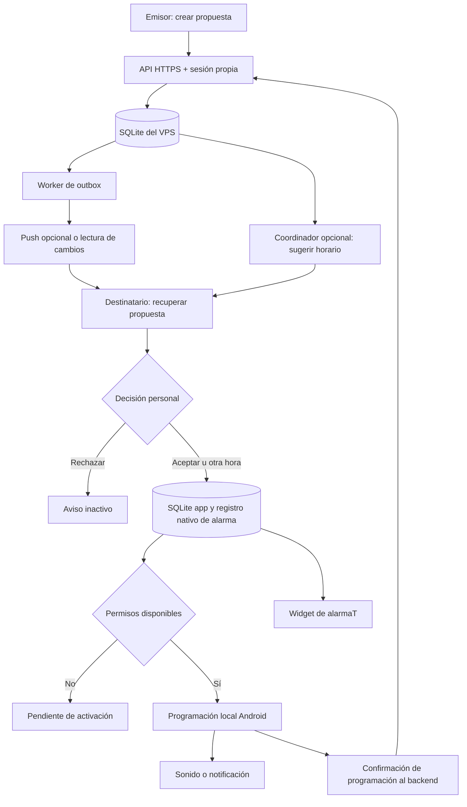

# alarmaT

Alarmas compartidas, bajo el control de quien las recibe.

> Nombre propuesto de la app: **alarmaT**. Repositorio: **HackatonETSE-ClosedAI**. Aplicación Android para proponer alarmas y notificaciones a otras personas, que pueden aceptarlas, rechazarlas o elegir otra hora antes de activarlas en su móvil.

**Estado: estructura inicial y cambio de arquitectura documentado.** El backend objetivo es una API propia con SQLite en el VPS. El código de `functions/` y la configuración `firebase/` siguen siendo el scaffold anterior, pendiente de migración por P3 a `server/`. La app, widgets y alarmas reales todavía requieren integración. Este cambio de documentación no despliega ni migra datos.

**Empieza aquí:** [guía de arranque y reparto por persona](docs/START_HERE.md). Incluye comandos reales y el primer archivo que debe modificar cada responsable.

**Para continuar con agentes:** [seis prompts extensos por persona y encargos para subagentes](docs/prompts/README.md), con el reparto de START_HERE.

## Documentación

- [FEATURES.md](FEATURES.md): listado de funcionalidades, prioridades y reglas de aceptación de avisos.
- [TDD](docs/TDD.md): diseño técnico, contratos, datos, estados y estrategia de pruebas.
- [Contratos v1](docs/CONTRACTS.md): sobre de operaciones, estados, tiempo, errores y fixtures compartidos.
- [Rutas y deep links](docs/ROUTES.md): nombres acordados para pantallas y widget.
- [Decisiones (ADR)](docs/adr/): base Expo y lockfile, ejes de estado y política de cambio horario.
- [Plan para seis personas](docs/TEAM_PLAN.md): responsables, dependencias y entregas diarias.
- [Estado de las prácticas a octubre de 2026](docs/STATE_OF_THE_ART.md): investigación y decisiones aplicadas al proyecto.
- [Buenas prácticas Android](docs/ANDROID_PRACTICES.md) y [SQLite/VPS](docs/SQLITE_VPS_PRACTICES.md): referencias técnicas verificadas.
- [CONTRIBUTING.md](CONTRIBUTING.md): organización del código, colaboración y criterios de revisión.
- [Cambio a SQLite/VPS](docs/MIGRATION_SQLITE.md): cambios por persona y trabajo de migración pendiente.
- Este README: alcance, decisiones técnicas, arquitectura, criterios de aceptación y plan de desarrollo.
- [LICENSE](LICENSE): licencia MIT del repositorio.

El listado de funcionalidades es la referencia de alcance. Una casilla sin marcar significa que está pendiente de implementación. El MVP cubre el flujo esencial; las ampliaciones se desarrollarán después de validar ese recorrido.

## La idea

alarmaT permite pedir a otra persona que active un aviso para un compromiso compartido. El emisor propone el motivo y el horario; el destinatario conserva el control sobre lo que se programa y suena en su móvil.

**Ejemplo:** «Ana, ¿te pongo una alarma para sacar la basura a las 21:00?». Ana recibe la propuesta y elige aceptar, rechazar o activar su aviso a otra hora. La app distingue que el aviso haya sido propuesto, recibido, aceptado y efectivamente programado en el dispositivo.

Prioridades del producto:

1. **Alarmas y notificaciones a otros:** creación, envío, aceptación personal y programación local.
2. **Widgets y tareas compartidas:** próximos avisos, propuestas pendientes y compromisos asociados.
3. **Gastos, huchas y presupuestos:** módulos secundarios para el caso de uso de convivencia.

La capacidad agéntica ayuda a interpretar peticiones y proponer horarios o cambios. El recorrido de alarmas funciona también sin IA. El caso inicial es un piso compartido, pero un aviso puede enviarse a un miembro sin crear una tarea ni registrar un gasto.

## Para quién

- Personas que comparten piso.
- Parejas que organizan su hogar.
- Grupos que comparten gastos y responsabilidades durante una estancia o viaje.

El MVP se centra en un grupo de entre dos y seis personas y una demo entre dos móviles Android. Gastos y huchas siguen en el alcance del proyecto, pero no bloquean la validación del núcleo de alarmas.

## Funcionalidades

### Núcleo: poner una alarma a otra persona mediante una propuesta

El creador elige destinatarios del grupo, título, fecha, hora, zona horaria, tipo de aviso y recurrencia opcional. Cada destinatario decide de forma independiente. Una tarea asociada es opcional.

| Estado | Qué significa |
|---|---|
| Propuesta enviada | El servidor ha guardado la petición; no demuestra recepción en el móvil. |
| Recibida | El dispositivo destinatario confirma que obtuvo la propuesta. |
| Aceptada | El usuario autoriza el aviso, pero todavía puede faltar un permiso o la programación local. |
| Rechazada | El aviso queda inactivo para ese destinatario. |
| Programada | El dispositivo confirma la programación de la versión y hora aceptadas. |
| Pendiente de activación | El usuario aceptó, pero falta un requisito técnico. |
| Cancelada o caducada | La propuesta se retiró o su fecha pasó antes de poder activarse. |

Una alarma local programada no necesita que llegue un mensaje push justo a la hora de sonar. La entrega de propuestas, cambios y cancelaciones remotas sí necesita comunicación. Una cancelación remota sin confirmar por el dispositivo se muestra pendiente; no se garantiza detener una alarma en un móvil desconectado.

Para el MVP, cada destinatario utiliza un dispositivo de alarma principal. La gestión simultánea de varios dispositivos por persona se pospone.

### 1. Lista de tareas con horarios

Cada tarea debe permitir configurar:

| Campo | Propósito |
|---|---|
| Título y descripción | Explicar qué hay que hacer. |
| Responsable | Elegir una persona o utilizar una rotación acordada. |
| Fecha y hora de asignación | Indicar cuándo pasa a estar activa para su responsable. |
| Fecha y hora límite | Indicar cuándo debe completarse. |
| Recordatorios | Proponer cuándo avisar y activarlo en el móvil de cada destinatario cuando lo acepte. |
| Recurrencia | Repetir diariamente, semanalmente o en días seleccionados. |
| Categoría | Agrupar limpieza, compras, mantenimiento u otras tareas. |
| Esfuerzo estimado | Usar minutos o puntos acordados para comparar cargas. |
| Estado | Programada, pendiente, completada o cancelada. |

Una tarea vencida se identifica por su fecha límite y estado. Las peticiones de intercambio se registran como propuestas independientes para conservar el responsable actual hasta que el cambio se apruebe.

**Ejemplo:** limpiar la cocina se asigna el lunes a las 09:00, debe completarse antes de las 20:00 y propone un recordatorio a las 18:00. El destinatario puede aceptarlo, rechazarlo o elegir otra hora. La semana siguiente corresponde a otra persona según la rotación.

Acciones principales:

- Marcar como completada y consultar quién la completó y cuándo.
- Posponer un recordatorio sin cambiar silenciosamente el vencimiento.
- Indicar «No puedo» y proponer otra fecha o un intercambio.
- Consultar las tareas propias y las del piso.

Los horarios utilizan la zona horaria del piso. La precisión de las notificaciones dependerá de permisos y restricciones de Android; el prototipo debe comprobar su comportamiento en un dispositivo real.

### Alarmas y recordatorios con aceptación personal

Cada persona decide qué avisos se activan en su móvil. Al recibir una propuesta de recordatorio, puede:

- **Aceptar:** autorizar su programación a la hora propuesta.
- **Rechazar:** mantener el recordatorio desactivado para ella.
- **Elegir otra hora:** autorizar un horario propio sin cambiar la fecha límite de la tarea.
- **Desactivar después:** cancelar un aviso previamente aceptado.

La propuesta aparece en la app y el widget. Un aviso para revisarla solo se envía si el usuario ha habilitado las notificaciones de propuestas; no activa por sí mismo el recordatorio solicitado.

```text
🔔 RECORDATORIO PROPUESTO
Sacar la basura · hoy a las 21:00
¿Quieres que te avisemos a las 20:30?
[Aceptar] [Otra hora] [Rechazar]
```

La decisión es individual: aceptar un aviso no lo activa para los demás miembros. Rechazarlo tampoco cancela la tarea, cambia su responsable ni equivale a pulsar «No puedo». Si una propuesta queda sin respuesta, el recordatorio permanece inactivo.

En tareas recurrentes, el usuario elige entre aceptar solo esta ocasión o autorizar futuros recordatorios con el mismo horario y configuración. Una modificación de la configuración requiere renovar esa autorización; una tarea completada o cancelada anula los avisos pendientes.

La app distingue **aceptado** de **programado en el dispositivo**. Si faltan permisos o no se puede programar, muestra el estado pendiente y la acción necesaria para activarlo, sin afirmar que ya está activo.

El MVP debe validar dos modalidades: **recordatorio mediante notificación** y **alarma sonora programada**. El destinatario elige el modo y las preferencias permitidas por Android. Si faltan permisos para la modalidad solicitada, se muestra pendiente de activación; no se sustituye silenciosamente una alarma por una notificación menos precisa.

Las preferencias de propuestas y las de avisos ya aceptados son independientes. El usuario puede silenciar nuevas propuestas de un miembro sin modificar automáticamente sus compromisos existentes.

### 2. Reparto de gastos al estilo Tricount

Registrar un gasto con importe, moneda, fecha, categoría, persona que pagó y participantes.

Repartos previstos para el módulo de gastos:

- A partes iguales entre los participantes seleccionados.
- Por importes personalizados que sumen el total.

Mostrar:

- Cuánto ha adelantado cada persona.
- Cuánto le corresponde asumir.
- Saldo neto a favor o pendiente.
- Transferencias sugeridas para liquidar saldos.
- Historial de gastos y liquidaciones registradas.

**Ejemplo:** Ana paga 60 € por una compra compartida entre tres personas. A cada una le corresponden 20 €; Ana tiene 40 € a favor y las otras dos personas deben 20 € cada una.

La referencia a Tricount describe la experiencia deseada. El MVP no requiere integrarse con su servicio ni importar sus datos.

Se trabajará con una sola moneda por piso y cantidades enteras en céntimos. Los repartos y redondeos se calculan mediante código, con una regla consistente para distribuir céntimos sobrantes.

### 3. Huchas por categorías y presupuestos

Una categoría puede tener un presupuesto de gasto, una hucha de ahorro o ambos. Son conceptos distintos:

| Concepto | Ejemplo | Qué muestra |
|---|---|---|
| Presupuesto | Destinar hasta 300 € al mes a alimentación | Gasto del periodo y cantidad restante. |
| Hucha | Ahorrar 240 € para una aspiradora | Aportaciones, retiradas registradas y progreso hacia el objetivo. |

Configuración prevista:

- Nombre, categoría y miembros participantes.
- Presupuesto mensual opcional.
- Objetivo de ahorro y fecha objetivo opcionales.
- Aportaciones previstas por miembro y aportaciones efectivamente registradas.
- Umbral configurable para avisar de que el presupuesto está cerca de agotarse.

Categorías iniciales sugeridas: alimentación, limpieza, suministros, mantenimiento y planes del piso. El grupo puede crear otras.

**Ejemplos:**

- Alimentación: presupuesto de 300 € al mes; gastos registrados de 180 €; quedan 120 €.
- Aspiradora: objetivo de 240 €; tres aportaciones registradas de 40 €; hay 120 € acumulados y faltan 120 €.

Las huchas son un **registro virtual**, no una cuenta bancaria. Las aportaciones previstas no aumentan el saldo hasta que se registran como realizadas.

Para evitar contar el mismo dinero dos veces:

- Un gasto personal adelantado para el grupo genera un reparto entre participantes.
- Un gasto pagado con una hucha reduce su saldo y consume presupuesto en su categoría, pero no vuelve a generar una deuda personal por el mismo importe.
- Una aportación a una hucha aumenta su saldo; no se contabiliza como consumo del presupuesto de la categoría.
- Registrar una liquidación reduce una deuda; no crea un gasto nuevo.

## Widgets Android

### Mis alarmas

Mostrar la próxima alarma aceptada, su hora efectiva, quién la propuso, propuestas pendientes y estado de programación. Permitir aceptar, rechazar, cambiar la hora y desactivar mediante una acción directa o una pantalla específica si hace falta más información.

### Mis tareas

Mostrar próximas tareas, responsable, vencimiento y acciones de completar, recordar más tarde o proponer un cambio.

### Gastos del piso

Mostrar saldo personal, gastos pendientes de aclarar y acceso directo para añadir un gasto o registrar una liquidación.

### Hucha y presupuesto

Mostrar una categoría seleccionada, progreso hacia su objetivo de ahorro y presupuesto restante del periodo.

Ejemplo orientativo de contenido:

```text
🏠 MI PISO

HOY · Cocina · 20:00
Responsable: tú
[Hecho] [Recordar después] [No puedo]

GASTOS
Tu saldo pendiente: 18,50 €
[Ver detalle]

ALIMENTACIÓN · ESTE MES
Gastado: 180 € de 300 €
Disponible: 120 €

HUCHA ASPIRADORA
Ahorrado: 120 € de 240 €
[Registrar aportación]
```

El MVP implementará primero un widget de alarmas y propuestas, con contexto de tarea cuando exista. Los widgets financieros se añadirán después de validar el recorrido principal.

Los widgets mostrarán la última sincronización y distinguirán los cambios pendientes de enviar de los ya confirmados por el servidor. Una acción que necesite aclaración o confirmación podrá abrir directamente la pantalla correspondiente.

## Diferenciación e ideas agénticas

### Missing Piece: resolver únicamente la información que falta

El coordinador consulta tareas, disponibilidad declarada y acuerdos. Si no puede proponer una solución, pide el dato que cambia la decisión.

Ejemplo: una persona estará fuera hasta el jueves y tiene asignada una limpieza el martes. El sistema busca alternativas compatibles y pregunta si quiere proponer un intercambio concreto.

En gastos, puede preguntar quién participa en un producto personal dentro de una compra común. No inventa participantes, aportaciones o disponibilidad.

### Teachback: convertir correcciones en acuerdos explícitos

Una corrección puede convertirse en una regla propuesta:

> «Los productos de limpieza se reparten entre todos aunque alguien esté fuera».

La regla debe mostrar su alcance y un ejemplo. Los cambios que afecten al grupo requieren confirmación según el acuerdo del piso. Se conserva la versión aplicada a cada operación.

### Morph: presentar la siguiente acción útil

Seleccionar entre plantillas de widget diseñadas previamente según tareas próximas, propuestas pendientes y presupuestos. No se necesita generar interfaces arbitrarias con IA.

### Reorganización explicable

Cuando una persona pulsa «No puedo», el sistema propone un cambio y explica las restricciones utilizadas:

> «Ana puede hacer cocina el martes. Tú puedes hacer baño el viernes. El intercambio mantiene la carga semanal acordada».

La equidad se define mediante reglas del grupo: rotaciones, disponibilidad y esfuerzo estimado. El modelo no decide unilateralmente qué es justo.

## Alcance y orden de desarrollo

### P0 — MVP centrado en alarmas

- [ ] Crear un grupo e invitar miembros.
- [ ] Enviar una propuesta de alarma o recordatorio a uno o varios miembros.
- [ ] Permitir avisos independientes o vinculados a una tarea.
- [ ] Crear tareas básicas con responsable, asignación, vencimiento y estado de finalización.
- [ ] Aceptar, rechazar, cambiar la hora y desactivar individualmente.
- [ ] Distinguir envío, recepción, aceptación y programación efectiva.
- [ ] Validar notificación estándar y alarma sonora con los permisos correspondientes.
- [ ] Resolver avisos puntuales y una recurrencia semanal con aceptación explícita.
- [ ] Instalar un widget de próximas alarmas y propuestas pendientes.
- [ ] Persistir el estado y probar programación con el proceso cerrado.
- [ ] Sincronizar entre dos móviles sin duplicar propuestas ni avisos.
- [ ] Gestionar falta de permisos, cambios de horario y cancelaciones pendientes de sincronización.

### P1 — módulos que completan el producto

- [ ] Rotar tareas y proponer intercambios explicables.
- [ ] Interpretar peticiones y aclarar datos con el coordinador de IA.
- [ ] Registrar gastos, repartos, saldos y liquidaciones.
- [ ] Crear presupuestos por categoría e huchas con aportaciones y objetivos.
- [ ] Añadir widgets financieros y reglas de convivencia versionadas.

### P2 — ampliaciones

OCR de recibos con evidencia visual, calendarios externos, reparto por porcentajes, varias monedas y aplicación iOS. El alcance detallado y las prioridades están en [FEATURES.md](FEATURES.md).

Quedan fuera del MVP los pagos bancarios reales, la lectura automática de conversaciones privadas, los sensores biométricos y un agente autónomo por cada miembro.

## Tecnologías: rapidez de desarrollo, ejecución y ligereza

**Stack elegido: Expo + React Native + TypeScript + Expo Router, API Node.js/Fastify y SQLite en el VPS disponible.** La aplicación consulta una API HTTPS; nunca abre ni descarga el archivo SQLite del servidor. P3 implementa backend y agente; P5 integra cliente HTTP y almacenamiento local.

| Capa | Tecnología propuesta | Responsabilidad |
|---|---|---|
| Pantallas y navegación | Expo, React Native, TypeScript y Expo Router | Desarrollo móvil con el stack ya fijado. |
| Widgets | expo-widgets | Proyección y enlaces en development build; entorno aislado. |
| Datos locales del móvil | expo-sqlite | Caché/proyección e intenciones pendientes de ese usuario. |
| Sesión móvil | Cliente HTTP + Expo SecureStore | Token de sesión; nunca contraseñas persistidas ni claves de servidor. |
| Backend | Node 22, TypeScript y Fastify | Endpoints HTTPS, validación y autorización en cada operación. |
| Base compartida | SQLite + better-sqlite3 en disco local del VPS | Usuarios, grupos, propuestas, decisiones, versiones, operaciones y outbox. |
| Identidad | Auth propia y sesiones opacas | Contraseñas con Argon2id, hash de token en servidor, expiración y revocación. |
| Sincronización | Lecturas HTTP y cursor por usuario; SSE opcional en primer plano | Recuperar cambios y conciliar al abrir/reanudar; no garantizar ejecución con app cerrada. |
| Recordatorios | expo-notifications | Programación/presentación de notificaciones locales según capacidades comprobadas. |
| Alarma sonora | Módulo Expo local + Kotlin/AlarmManager | Registro y ejecución nativos independientes del runtime JS. |
| Push opcional | Expo Push Service + expo-notifications | Aviso de cambios; Android utiliza FCM como transporte y necesita configuración Google. No se usa Firebase como backend ni RNFirebase. |
| Cálculos | Código determinista | Consentimiento, versiones, horarios y repartos; separados del modelo de IA. |

### Rapidez, ligereza y límites

Se reutiliza el VPS y una base SQLite local al servidor para evitar operar una base externa durante el hackathon. Eso añade responsabilidad de autenticación, TLS, backups y mantenimiento. La decisión de implementación es un servicio sencillo en un único host, consultas indexadas y transacciones cortas; no se prometen benchmarks ni escalado horizontal automático.

Los componentes leen proyecciones locales y utilizan puertos de repositorio. Se mantienen los contratos JSON del dominio, incluidos `operationId`, versiones y acuses. Los errores HTTP se traducen al contrato de aplicación en el adaptador; el móvil no recibe SQL ni rutas internas.

SQLite del VPS, SQLite del móvil y registro nativo de alarmas son **tres almacenamientos con funciones distintas**. P5 implementa sincronización explícita; los archivos no se replican entre sí. Una nueva aceptación offline queda pendiente de confirmación del servidor, mientras una alarma ya programada puede ejecutarse sin red.

### Desarrollo y notificaciones

Las integraciones nativas requieren development build. La ejecución del widget, el estado React y la programación del sistema no comparten automáticamente memoria ni almacenamiento. Las acciones que necesiten consentimiento, sesión o permisos abren la pantalla correspondiente.

El push es opcional para validar el recorrido con ambos móviles abiertos. Si se habilita Expo Push Service, se documentarán sus credenciales y el transporte FCM de Android. Prescindir también de ese transporte permite sincronizar al abrir/reanudar y ejecutar alarmas ya aceptadas, pero no garantiza recibir invitaciones con la app cerrada. SQLite y un socket no sustituyen un servicio push del sistema.

### Persistencia y operación del VPS

P3 define migraciones SQL, claves foráneas, índices y restricciones únicas para idempotencia, activa WAL y un tiempo de espera acotado para bloqueos. Se utiliza disco persistente local al servidor; no compartir el archivo entre hosts mediante una unidad de red. Las transacciones guardan cambio, resultado idempotente y evento de outbox juntos; el worker envía push después de confirmar la transacción.

Los tests del nuevo backend usarán API HTTP y bases SQLite temporales con migraciones reales. El despliegue requiere dominio/HTTPS, configuración privada, supervisión del proceso, backups consistentes y prueba de restauración. No se han facilitado aquí IP, dominio ni credenciales: quedan como configuración del entorno, sin inventar valores.

El diseño detallado y las fuentes están en [SQLite/VPS](docs/SQLITE_VPS_PRACTICES.md) y [ADR-004](docs/adr/004-vps-sqlite.md). `functions/` sigue presente como legado: pasar su compilación no valida el backend nuevo. Los comandos actuales se explican en [START_HERE](docs/START_HERE.md).

### Prueba técnica del primer día

**Móvil A propone → móvil B recibe → B acepta → B programa localmente → se cierra su proceso → se dispara el aviso → B lo detiene o pospone.**

Repetir rechazando la propuesta y cambiando su hora. Verificar además que el widget refleja el estado persistido y que el emisor no confunde una propuesta enviada con una alarma ya activada.

Cerrar el proceso no equivale a forzar la detención desde ajustes. Se deben probar por separado pantalla bloqueada, ahorro de batería, reinicio, falta de conexión y detención forzada, documentando los límites observados.

### Funcionamiento eficiente y límites reales

1. Mostrar el último estado local y recuperar cambios por eventos o al reconectar.
2. Guardar una identificación y versión por propuesta, destinatario y programación. Reintentar sin duplicar alarmas.
3. Usar el sistema de alarmas después de la aceptación; no mantener un proceso comprobando la hora cada segundo.
4. Diferenciar el permiso de notificaciones del acceso requerido para alarmas exactas. Comprobar requisitos según versión y modalidad antes de mostrar «Programada».
5. Si la fecha pasó antes de recibir o aceptar la propuesta, marcarla caducada y ofrecer otra hora. No activar un aviso antiguo automáticamente.
6. Al reiniciar o cambiar la hora o zona horaria, reconciliar las programaciones vigentes con el estado persistido. La recuperación tras reinicio requiere primer desbloqueo en el MVP; Direct Boot queda fuera.
7. Una modificación remota solo se considera aplicada cuando el dispositivo confirma su versión. La desconexión puede retrasar cambios y cancelaciones.
8. Actualizar widgets con resúmenes pequeños y ya calculados. La generación de propuestas de IA queda fuera de su renderizado.
9. Limitar la IA a interpretación y sugerencias. Los avisos aceptados y funciones básicas no dependen de su disponibilidad.

No se promete sonar con el teléfono apagado, ignorar la configuración del usuario o garantizar entrega remota instantánea. La pantalla de permisos y los estados deben explicar las limitaciones relevantes para activar un aviso. Referencias: [alarmas Android](https://developer.android.com/develop/background-work/services/alarms) y [permiso de notificaciones](https://developer.android.com/develop/ui/compose/notifications/notification-permission).

### Medidas de rapidez y ligereza

Medir en una compilación de distribución y un móvil Android de referencia: tamaño instalado, arranque en frío, memoria en reposo, tiempo hasta mostrar alarmas locales, latencia de recepción y sincronización, desviación respecto a la hora programada y batería con avisos activos.

Son criterios de evaluación previstos, no resultados obtenidos. Los objetivos numéricos se fijarán tras la primera medición. La latencia de IA se medirá por separado del recorrido de alarmas.

## Arquitectura prevista



Un aviso remoto comunica que hay cambios; el dispositivo recupera y valida la propuesta. El destinatario autoriza la programación local. Las propuestas de IA recorren la misma aceptación y no activan alarmas por sí solas.

Una aceptación y su programación son operaciones distintas: se conserva el estado intermedio para recuperarse de errores. El evento de disparo tampoco demuestra que una persona oyera el sonido o completara su tarea; únicamente una acción explícita permite registrar su respuesta.

Las asignaciones de tareas pueden seguir una rotación acordada. Cambiar compromisos existentes requiere la aceptación correspondiente. Los secretos de IA y del proveedor push permanecen en el entorno de servidor y cada operación comprueba identidad, pertenencia y permisos.

## Modelo de datos inicial

El [TDD](docs/TDD.md) y [SQLite/VPS](docs/SQLITE_VPS_PRACTICES.md) describen tablas y API. Los DTO de dominio mantienen sus nombres y validadores; una fila SQL no se expone directamente como respuesta pública.

| Tabla o registro | Contenido |
|---|---|
| `users`, `sessions` | Usuarios, verificación de contraseña y sesiones con token hasheado. |
| `groups`, `memberships`, `invitations` | Grupos, roles y acceso por invitación. |
| `alarm_requests`, `alarm_recipients` | Propuesta, destinatarios, decisión individual y versiones. |
| `device_schedules` | Acuse por ocurrencia/dispositivo, estado y revisiones. |
| `devices` | Tokens push privados e identidad de instalación; principal/epoch asociados al usuario. |
| `tasks` | Tareas y vínculo con propuestas. |
| `operations`, `outbox_events`, `change_events` | Idempotencia, trabajo de entrega y sincronización autorizada. |
| SQLite móvil | Proyección e intenciones de la sesión local. |
| Registro nativo | Ocurrencias realmente programadas y cancelaciones locales. |

Los módulos financieros siguen en P1 y se incorporarán con migraciones específicas. Las decisiones de un destinatario no invalidan las de otro.

## Criterios de aceptación

### Alarmas, tareas y widgets

- Una alarma independiente puede proponerse entre dos móviles y solo se programa tras aceptar en el destinatario.
- La demo verifica disparo real, detener y posponer; un push recibido no cuenta como prueba de alarma.
- Las propuestas caducadas no se activan automáticamente y una cancelación remota queda pendiente hasta confirmar su aplicación.
- Una tarea programada se activa una sola vez y con el responsable previsto.
- Completar una tarea actualiza el estado compartido sin duplicar eventos.
- Posponer un recordatorio conserva el vencimiento salvo edición explícita.
- Un recordatorio sin respuesta o rechazado no se programa; aceptar no activa avisos para otros miembros.
- Rechazar un aviso conserva la tarea y su responsable.
- Aceptar una propuesta repetidamente no duplica el aviso; cambiar su hora sustituye la programación anterior.
- Desactivar el recordatorio o completar o cancelar la tarea cancela sus avisos pendientes.
- Una aceptación recurrente solo se reutiliza mientras se mantenga la configuración autorizada.
- Si faltan permisos, la interfaz distingue la aceptación del usuario de la programación efectiva.
- Se verifica el comportamiento de avisos con permisos denegados, ahorro de batería y reinicio del dispositivo.
- Un cambio sin conexión aparece pendiente y se sincroniza al recuperar conectividad.
- Una propuesta se vuelve a validar si cambia la tarea o disponibilidad antes de su aceptación.

### Gastos y huchas

- Las participaciones de un gasto suman exactamente su importe.
- Los saldos netos del grupo suman cero para los gastos personales y liquidaciones.
- Una liquidación repetida por un reintento se registra una sola vez.
- Un gasto de hucha reduce su saldo sin crear una deuda personal duplicada.
- Las aportaciones previstas no se muestran como dinero ya disponible.
- Presupuesto restante y ahorro acumulado se presentan como cantidades distintas.
- Ningún miembro puede consultar o modificar datos de un piso al que no pertenece.

### Coordinador

- Cada propuesta identifica los datos y acuerdos utilizados.
- Los cambios de responsables respetan las aceptaciones necesarias.
- Si no existe un intercambio válido, el sistema lo indica y pide una aclaración concreta.
- Tareas, gastos y presupuestos siguen siendo utilizables si el modelo no responde.

## Plan de hackathon

Estimación orientativa para seis personas durante cuatro días. El recorrido de alarmas tiene prioridad sobre los módulos de convivencia. El reparto por persona y las estimaciones están en [TEAM_PLAN.md](docs/TEAM_PLAN.md).

| Día | Resultado esperado |
|---|---|
| 1 | Propuesta entre dos móviles, aceptación y programación local; validar el stack con pruebas reales. |
| 2 | Rechazo, otra hora, desactivación, persistencia, permisos y widget de alarmas. |
| 3 | Recurrencia semanal, recuperación de estado, tarea asociada y sugerencia de horario si el núcleo ya funciona. |
| 4 | Pruebas con app cerrada y pantalla bloqueada, sincronización, diseño final y demo. Gastos e huchas solo si queda capacidad. |

Cada persona tiene una responsabilidad y rutas de código asignadas en el plan de equipo. Los contratos se acuerdan el primer día y se integra el recorrido entre dos móviles a diario. IA y módulos financieros se incorporan tras superar los criterios del núcleo.

## Demo de tres minutos

1. En el móvil A, proponer a B una alarma para un compromiso próximo.
2. En B, enseñar quién la propone y elegir otra hora; mostrar aceptación y confirmación de programación como estados distintos.
3. Volver a inicio y mostrar la alarma en el widget.
4. Cerrar la app y bloquear la pantalla; comprobar el aviso programado y detenerlo o posponerlo.
5. Enviar una segunda propuesta y rechazarla; comprobar que no aparece como alarma activa.
6. Mostrar una petición vinculada a una tarea y, si está disponible, una alternativa de horario propuesta por el coordinador.

Los horarios cortos utilizados durante la demo son datos de prueba. No presentar un aviso simulado como una alarma real de Android. Gastos y huchas pueden mostrarse al final como módulos secundarios, diferenciando lo implementado del diseño previsto.

Métricas: tiempo desde propuesta hasta programación, decisiones respetadas, duplicados, recepción entre dispositivos y desviación del disparo local respecto a su horario. No se anuncian mejoras porcentuales sin medirlas.

## Preparación del desarrollo

El repositorio incluye una estructura inicial con scripts de arranque, comprobación TypeScript y compilación del backend. Sigue [START_HERE](docs/START_HERE.md) para ejecutarla. Las siguientes integraciones siguen pendientes.

Antes de desarrollar:

1. Validar Expo y la API del VPS con la prueba completa de alarma entre dos móviles con la app cerrada.
2. Preparar un teléfono Android real y el entorno de compilación.
3. Crear el proyecto Expo con TypeScript y Router, fijar dependencias y generar una development build Android.
4. Implementar API, sesiones, migraciones e índices SQLite y pruebas de autorización con bases temporales.
5. Crear cuentas de demo y datos de ejemplo.
6. Preparar HTTPS, volumen persistente, backups y worker del VPS; habilitar push opcional y proveedor de IA solo desde configuración de servidor.
7. Añadir al README los comandos reales de instalación, compilación y pruebas cuando existan.

## Referencias

- [Noi: Life, together](https://apps.apple.com/au/app/noi-life-together/id6815619855): referencia de organización compartida; el proyecto no está afiliado a Noi.
- [Expo Widgets](https://docs.expo.dev/versions/latest/sdk/widgets/): compatibilidad, configuración y límites de widgets.
- [Jetpack Glance](https://developer.android.com/develop/ui/compose/glance): alternativa nativa Android.
- [Actualización de widgets Android](https://developer.android.com/develop/ui/views/appwidgets/advanced): actualización por eventos y restricciones periódicas.
- [SQLite WAL](https://sqlite.org/wal.html): concurrencia y límites del archivo compartido.
- [Fastify](https://fastify.dev/docs/latest/): API HTTP del servidor.
- [Expo SQLite](https://docs.expo.dev/versions/latest/sdk/sqlite/): persistencia local.
- [Expo Notifications](https://docs.expo.dev/versions/latest/sdk/notifications/): programación y gestión de avisos.
- [SQLite Backup API](https://sqlite.org/backup.html): copias consistentes de la base.

## Pitch

> «¿Te pongo una alarma?». Con alarmaT puedes proponer un aviso a otra persona y saber si lo ha aceptado y activado. Quien lo recibe decide si le viene bien, cambia la hora o lo rechaza. Los próximos compromisos quedan visibles en un widget y las alarmas aceptadas se programan en su móvil.
