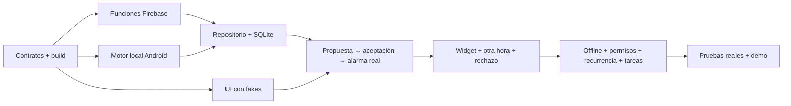

# alarmaT — Plan de ejecución para seis personas

**Estado:** plan propuesto; personas y horas se asignan al empezar. Equipo de **seis personas**, **cuatro días**, **6–8 horas por persona y día**. Los identificadores P1–P6 de personas no son las prioridades P0/P1/P2 del producto. Base de planificación: 7 horas/día, 28 horas por persona, **168 horas-persona** en total. No es una promesa de completar todos los módulos secundarios.

Producto y alcance en [FEATURES](../FEATURES.md); contratos, arquitectura y pruebas en [TDD](TDD.md). El primer resultado competitivo es enviar una alarma entre dos móviles, aceptar/rechazar/cambiar hora y mostrar programación real en un widget.

Ya hay puntos de entrada para cada persona: [estructura inicial y comandos](START_HERE.md). Las rutas de este plan son el objetivo completo; parte existe como scaffold y el resto sigue pendiente.

## 1. Reparto de responsabilidad

Se utiliza **un proyecto Expo + React Native + TypeScript**, Expo Router, backend Firebase y un módulo Expo nativo local acotado para las alarmas audibles. Se trabaja con development builds, no Expo Go. Cada persona tiene una zona principal y una entrega consumible por las demás. Ser owner significa mantener la coherencia de esa zona, no bloquear revisiones ni trabajar aislado.

| Persona | Responsabilidad y rutas a crear | Entrega principal | Revisor cruzado |
|---|---|---|---|
| **P1 — Base Expo y contratos** | Configuración Expo, lockfile, plugins, rutas/layouts comunes `app/`, `src/domain/`, `contracts/`. | Development build, tipos/puertos, fixtures, Clock y composición de dependencias. | P3 para contratos; P6 para build. |
| **P2 — Experiencia de producto** | `src/features/auth/`, `groups/`, `alarms/` y sus rutas finas `app/`. | Crear grupo/propuesta, bandeja, aceptar/rechazar/otra hora y estados pendientes claros. | P6 para usabilidad; P4 para permisos. |
| **P3 — Firebase y seguridad** | `functions/`, `firebase/`, pruebas de reglas. | Auth/grupos/invitaciones, operaciones versionadas/idempotentes, Firestore, FCM, emuladores. | P1 para contratos; P6 para escenarios. |
| **P4 — Runtime Android y avisos** | `modules/alarm-runtime/`, `src/platform/alarms/`, `notifications/`, plugins nativos acordados. | Alarma audible sin JS, store nativo, permisos/canales, programar/cancelar, detener/posponer y recuperación. | P6 en dispositivos; P1 para integración Expo. |
| **P5 — Datos y sincronización** | `src/data/`, `src/platform/sync/`, `src/bootstrap/`. | SQLite, outbox, RNFirebase único, reconciliación Firestore/runtime, handler background y snapshots. | P3 para backend; P4 para estado local. |
| **P6 — Widget, tareas e integración** | `src/widgets/`, `src/features/tasks/`, `.github/`, tests transversales, `docs/qa/` y demo. | Widget mínimo expo-widgets, tarea básica, CI, integración diaria y demo. | P2 para UX; P4/P5 para regresiones. |

Estas rutas son futuras; no se presuponen clases, scripts ni tests existentes. Las pruebas cercanas a cada feature pertenecen a su owner; P6 coordina calidad pero **no escribe todas las pruebas del equipo**. P1 es responsable de mantener compilación/CI junto con P6, que aporta escenarios de integración.

P5 tiene una dependencia amplia. P1 entrega tipos, interfaces y fakes temprano; P3 implementa y prueba todos los contratos del servidor; P4 implementa toda la lógica de programación; P5 se concentra en conectarlos. P6 concentra el widget en una única plantilla con deep links y una tarea básica, sin desarrollar un segundo sistema visual; P1 ayuda con CI y fixtures para dejarle capacidad de verificación.

## 2. Contratos y handoffs del primer día

| Momento objetivo | Quién entrega → quién consume | Contenido revisable |
|---|---|---|
| Hora 1 | P1 + P3 → todos | `schemaVersion`, IDs, estados, tiempo, errores y JSON de crear/responder/reportar. P4/P5 revisan identidad de ocurrencia. |
| Hora 2 | P1 → P2/P4/P5/P6 | Development build que compila, puertos `AlarmRepository`/`AlarmRuntime`, Clock y fakes suficientes para trabajar. |
| Hora 3 | P3 → P5/P6 | Operaciones crear/responder en emulador, dos usuarios/grupo de prueba y casos de denegación; payloads exactos. |
| Hora 4 | P4 → P5/P2 | Runtime mínimo probado en development build, store nativo, permisos y resultado tipado; detener sin JS. |
| Hora 5 | P5 → P2/P6 | Repositorio conectado a SQLite y backend, observable de bandeja, submit y estado de sincronización. |
| Cierre día 1 | Todos → equipo | Dos teléfonos: crear propuesta, verla, aceptar y programar un aviso puntual; lista de fallos reales y responsables. |

Los hitos son objetivos de coordinación, no autorizan omitir verificaciones para cumplir una hora. Si la integración se retrasa, se reduce trabajo de UI/estética/expansiones y se ayuda a la dependencia bloqueante.

## 3. Horas por persona y día

Las 7 horas incluyen 1 hora de coordinación, revisión e integración. Quedan 6 horas de trabajo enfocado. Si la jornada es de 6 horas, recortar una hora de construcción; si es de 8, dedicar la hora adicional a fallos o evidencia antes de ampliar alcance.

| Persona | Día 1 · 7 h | Día 2 · 7 h | Día 3 · 7 h | Día 4 · 7 h |
|---|---|---|---|---|
| P1 | 2 h build/base; 2 h contratos; 2 h navegación/fakes; 1 h integración. | 2 h dominio/versiones; 2 h fixtures/CI; 2 h soporte integración; 1 h revisión. | 2 h tiempo/recurrencia; 2 h inconsistencias contratos; 2 h accesibilidad/errores transversales; 1 h revisión. | 2 h release/configuración; 2 h regresión; 2 h fixes; 1 h ensayo. |
| P2 | 2 h Auth/grupo; 2 h formulario; 2 h bandeja/aceptación; 1 h integración. | 2 h rechazo/otra hora; 2 h estados/permisos; 2 h desactivar/pendientes; 1 h revisión. | 2 h tareas vinculadas; 2 h recurrencia/consentimiento; 2 h claridad visual; 1 h revisión. | 2 h bugs/edge cases; 2 h accesibilidad; 2 h demo UX; 1 h ensayo. |
| P3 | 2 h Firebase/emuladores; 2 h crear/responder/grupo; 2 h reglas/FCM; 1 h integración. | 2 h versiones/idempotencia; 2 h cancelar/reportar; 2 h tests de permisos/carreras; 1 h revisión. | 2 h invitaciones/dispositivo; 2 h invalidación por tareas; 2 h reintentos/eventos; 1 h revisión. | 2 h reglas/datos de demo; 2 h fallos/coste/logs; 2 h fixes; 1 h ensayo. |
| P4 | 2 h permisos y spike; 2 h programar/receptor; 2 h sonido/detener en teléfono; 1 h integración. | 2 h cancelar/sustituir; 2 h snooze/canales; 2 h cierre de proceso/bloqueo; 1 h revisión. | 2 h recurrencia; 2 h reinicio/tiempo; 2 h permisos revocados/tests; 1 h revisión. | 2 h matriz real; 2 h bugs sonido/ciclo vida; 2 h demo repetida; 1 h ensayo. |
| P5 | 2 h SQLite/outbox; 2 h API/listeners; 2 h repositorio/integración scheduler; 1 h integración. | 2 h reconciliación/reintentos; 2 h snapshot nativo/estado; 2 h listeners/handler background; 1 h revisión. | 2 h offline/tombstones; 2 h recovery/observabilidad; 2 h regresión proyecciones; 1 h revisión. | 2 h conflictos/limpieza sesión; 2 h fixes; 2 h rendimiento/estabilidad; 1 h ensayo. |
| P6 | 2 h fixture demo/CI con P1; 2 h spike widget; 2 h pruebas entre teléfonos; 1 h integración. | 2 h widget/deep links; 2 h tareas básicas; 2 h casos E2E; 1 h revisión. | 2 h ocurrencias de tarea; 2 h matriz QA; 2 h regresión/guion; 1 h revisión. | 2 h validación final; 2 h grabación/respaldo; 2 h demo/documentación; 1 h ensayo. |

El plan base consume las 168 horas en P0, integración y verificación. Las funcionalidades de prioridad P1 no tienen horas prometidas por defecto. Si sobra capacidad real, se reasigna una parte explícita; no se añaden tareas encima de jornadas ya completas.

## 4. Camino crítico y gates

### Gate 1 — cierre del día 1

- Development build Expo instalada en dos Android, módulos nativos presentes y backend reproducible.
- Propuesta guardada, recibida y aceptada con estados diferenciados.
- Un aviso puntual se programa y se puede detener en el receptor.
- Se conoce la vía viable de alarma sonora sin proceso JS y con permisos aplicables; cualquier bloqueo tiene owner y siguiente prueba concreta. Un aviso de expo-notifications no demuestra por sí solo la alarma audible P0; si falla el runtime nativo se recortan secundarios, no se marca como cumplida.

Si no pasa, el día 2 empieza con pareja P4/P6 en Android y pareja P3/P5 en entrega/repositorio; P1/P2 apoyan la interfaz mínima. No se abre IA, gastos, huchas ni estética adicional.

### Gate 2 — cierre del día 2

- Aceptar, rechazar, otra hora, desactivar y snooze funcionan sin duplicados.
- Widget muestra la fuente local y abre la acción correspondiente.
- Permiso denegado y falta de red no se presentan como éxito.
- Se demuestra una alarma con pantalla bloqueada/proceso cerrado y una propuesta rechazada que nunca se programa.
- Tests de autorización e idempotencia pasan; no hay credenciales sensibles en el repo.

Solo después de pasar este gate se decide si reservar **como máximo 8–12 horas-persona** para una única capacidad P1 que mejore el pitch. Esta reserva debe salir de trabajo P0 ya completado o capacidad adicional real, sin quitar las pruebas del día 4.

### Gate 3 — cierre del día 3

- Recurrencia semanal con alcance de consentimiento y tarea básica integrada.
- Recuperación/offline/cancelaciones pendientes con casos reproducibles.
- Datos y cuentas de demo listos, script de tres minutos y defectos priorizados.
- Congelación de funcionalidades. Los P0 no alcanzados quedan identificados en FEATURES y en el guion, sin presentarlos como realizados.

### Gate 4 — día 4

- Solo integración, bugs que afecten a demo, evidencia, release y ensayo.
- Dos ensayos completos consecutivos del camino principal en los teléfonos de demo.
- Resultado observado y limitaciones documentados; respaldo grabado claramente identificado como grabación de la app real.

## 5. Incremento P1 recomendado si hay capacidad

Para un hackathon de sistemas agénticos, el primer incremento útil es **convertir una petición natural en una propuesta estructurada y pedir únicamente la aclaración necesaria**: «Recuérdale a Ana sacar la basura cuando vuelva». Si no se conoce el horario, pedirlo; después enseñar destinatario, hora, fuente y motivo antes de enviar. Ana conserva la aceptación final.

Reparto acotado: P3 implementa endpoint de propuesta y validación; P2 implementa revisión/aclaración; P1 aporta fixtures; P6 prueba ambigüedad y fallo de modelo. No reemplaza reglas de tiempo ni scheduler. Estimación conjunta 8–12 h, solo para una interacción delimitada, sin agente permanente ni ecosistema de herramientas.

Los módulos financieros completos no caben dentro de esa misma reserva. Si el equipo decide priorizarlos, elige un único corte adicional y estima por separado: registro de gasto con reparto igual y saldo; después liquidaciones; después presupuestos; finalmente huchas. Una maqueta se etiqueta como tal.

## 6. Trabajo con Git y herramientas de vibe coding

1. Ramas cortas por entrega: `feat/alarm-scheduler`, `feat/alarm-inbox`, `feat/firebase-proposals`, etc. Los nombres son ejemplos, no ramas existentes.
2. Cada ticket define entrada, salida, ruta owner, contrato utilizado, casos de aceptación, estimación y dependencia. Un agente de código recibe estos mismos límites.
3. PR pequeños e integrables al menos una vez al día; preferiblemente dos. Incorporar interfaces/fakes antes de esperar una feature completa.
4. Cambios de `contracts/`, configuración Expo/plugins, lockfile, manifiesto generado, navegación o reglas Firebase se coordinan antes. P1 integra cambios comunes de configuración/plugins solicitados por P4/P5. Permisos/receptores deben sobrevivir a prebuild; no basta tocar un manifiesto generado. Cambios nativos requieren nueva development build.
5. Revisión cruzada obligatoria para consentimiento, autorización, versiones y programación. Para cambios visuales pequeños basta la revisión habitual de su owner/revisor; no convertir cada cambio en una ceremonia.
6. El código generado debe compilar, pasar los casos relevantes y ser comprendido por su owner. No aceptar nuevas dependencias, permisos Android o escrituras directas a Firestore sin revisar su necesidad.
7. Registrar decisiones y resultados reales. No marcar checkboxes porque un agente produjo código sin ejecutar el flujo.
8. No subir secretos ni logs privados. Los despliegues se hacen desde configuración reproducible y cuentas previstas para el proyecto.

Ritmo diario: 15 minutos de arranque, 15 minutos de revisión del camino crítico y 30 minutos de integración/revisión. Las discusiones largas se resuelven entre los owners afectados y se registran en un ADR breve.

## 7. Definition of Done

Una entrega está terminada cuando:

- Cumple el caso de aceptación del ticket y está integrada en la rama compartida.
- Respeta los contratos/versiones o incluye su actualización y consumidores.
- Tiene manejo explícito de error, carga y estado pendiente cuando correspondan.
- Incluye pruebas significativas de su comportamiento crítico; UI/Android real tienen evidencia adicional cuando el entorno influye.
- No introduce permisos, dependencias o datos sensibles sin revisión de su owner.
- Tiene revisión cruzada y CI pertinente en verde una vez exista la automatización.
- Actualiza FEATURES/documentación con estado observado, limitaciones y rutas reales.

Para una alarma, «terminada» exige demostrar recepción, decisión, programación, disparo y parada/posposición en el dispositivo acordado. Un push recibido o una notificación dibujada no acreditan ese recorrido completo.

## 8. Tablero inicial de tickets

| Ticket | Owner | Depende de | Resultado |
|---|---|---|---|
| A01 Build, paquetes y contratos v1 | P1 | — | App mínima y fixtures compartidos. |
| B01 Auth, grupo, invitación y reglas | P3 + UI P2 | A01 | Dos miembros autorizados; tercero denegado. |
| B02 Crear/responder/reportar propuestas | P3 | A01, B01 | Operaciones versionadas e idempotentes. |
| C01 Alarma local completa | P4 | A01 | Sonido/notificación y detener/posponer en teléfono. |
| D01 SQLite, repositorio, outbox y sync | P5 | A01, contratos B02/C01 | Proyección local y operaciones recuperables. |
| E01 Crear, bandeja y decisiones | P2 | A01; integrar con D01 | Flujo usable con estados reales. |
| E02 Widget y deep links | P6 | D01, E01 | Próxima alarma y propuesta pendientes. |
| F01 Tarea básica y vínculo | P6 | A01, B02, E01 | Fecha de activación/vencimiento y completar sin duplicación. |
| C02 Recurrencia, permisos y recuperación | P4 + P5 | C01, D01 | Siguiente ocurrencia y reconciliación documentadas. |
| Q01 CI, emuladores y matriz física | P6 + tests de cada owner | Desde A01, continuo | Evidencia de gates y fallos reproducibles. |
| Q02 Demo, release y documentación | P6 + todos | Gates 1–3 | Recorrido ensayado y alcance honesto. |

Los tickets agrupan entregas; se subdividen en tareas de aproximadamente 1–3 horas al asignar nombres reales. Las horas del calendario ya cubren estos tickets: no sumarlas de nuevo.
